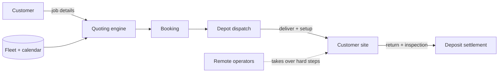

# Architecture — robot-rental

## 1. Scope
Rental counter for robots: job-based quoting, availability, delivery, operators, deposits, returns.
**MVP:** fleet model, job → requirement translation (move, deep_clean, event), cheapest
capability-matching selection per day, quote breakdown, booking without double-booking, return
inspection with deposit settlement.
**Product:** depot network, teleoperation fallback, insurance at checkout, utilisation analytics.

## 2. System context

## 3. Quoting
1. A job template translates parameters into needs. For example, a move becomes cargo
   (lift ≥ heaviest, stairs?) plus a humanoid if there are 3+ rooms, with estimated hours.
2. Greedy pick of the cheapest available robot meeting each need (no reuse within a job).
3. Price = Σ daily rates + delivery (km × 2 × rate) + operator hours (if any robot needs one).
   The refundable deposit is shown separately.

## 4. Design decisions
- **Job templates, not robot pickers.** Customers know "3-bedroom move with stairs", not payload specs.
- **Greedy cheapest-fit** is optimal for independent needs. *Trade-off:* it's not globally optimal
  when needs compete for scarce robots. An ILP (cuOpt / OR-Tools) is on the roadmap for multi-robot jobs.
- **Deposit settlement:** charges are `min(deposit, damage + late fees)`, and any excess becomes
  `extra_due`, never a silent overcharge.

## 5. Production architecture
Postgres (fleet, calendars via an exclusion constraint per robot-day, bookings, inspections with
photos), a routing service for delivery windows, a robot telemetry gateway (battery, location,
faults) and a teleop session broker.

## 6. Risks
Safety in homes (operator-required robots, geofenced task modes, insurance). Robot capability
claims are verified per model through a certification checklist.
