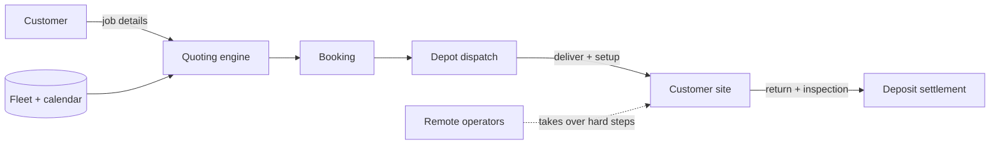

# Architecture — robot-rental

## 1. Scope
Rental counter for robots: job-based quoting, availability, delivery, operators, deposits, returns.
**MVP:** fleet model, job → requirement translation (move, deep_clean, event), cheapest
capability-matching selection per day, quote breakdown, booking without double-booking, return
inspection with deposit settlement.
**Product:** depot network, teleoperation fallback, insurance at checkout, utilisation analytics.

## 2. System context

## 3. Quoting
1. A job template translates parameters into needs. For example, a move becomes cargo
   (lift ≥ heaviest, stairs?) plus a humanoid if there are 3+ rooms, with estimated hours.
2. Greedy pick of the cheapest available robot meeting each need (no reuse within a job).
3. Price = Σ daily rates + delivery (km × 2 × rate) + operator hours (if any robot needs one).
   The refundable deposit is shown separately.

## 4. Design decisions
- **Job templates, not robot pickers.** Customers know "3-bedroom move with stairs", not payload specs.
- **Greedy cheapest-fit** is optimal for independent needs. *Trade-off:* it's not globally optimal
  when needs compete for scarce robots. An ILP (cuOpt / OR-Tools) is on the roadmap for multi-robot jobs.
- **Deposit settlement:** charges are `min(deposit, damage + late fees)`, and any excess becomes
  `extra_due`, never a silent overcharge.

## 5. Production architecture
Postgres (fleet, calendars via an exclusion constraint per robot-day, bookings, inspections with
photos), a routing service for delivery windows, a robot telemetry gateway (battery, location,
faults) and a teleop session broker.

## 6. Risks
Safety in homes (operator-required robots, geofenced task modes, insurance). Robot capability
claims are verified per model through a certification checklist.

## 7. Limitations (sell-ready audit, 2026-10-28)
- Bookings previously existed only as library code: the CLI and API exposed
  only fleet and quote, and every CLI run started with a fresh, fully-available
  fleet, so a quote never reserved anything. This run adds persistent
  `book`/`return` commands (CLI and API, via `_webspec.py` hand-updated to
  match the new parser — the generator is not in the repo) backed by a
  bookings JSON file; quotes now respect already-booked robots for the date.
- No feature gating by plan: every API key unlocks the same software. The
  fleet is a fixed 9-robot list in code, not configurable per customer;
  custom job types, reporting, a multi-operator marketplace, and rental
  payments are roadmap, not shipped, and were removed from sales copy.
- Bookings are a local JSON file, not a database: there is no concurrency
  protection beyond a single process, no authentication per booking (any API
  key can return any booking id), and no payment capture for a booking — the
  quote total is an estimate, Stripe only sells API-key subscriptions.
- Docker build and a live Render/Fly deployment were not verified in the audit
  environment (no Docker binary there); Dockerfile, render.yaml, and fly.toml are
  the same template shape as vibe-lube, but a deployment claim remains
  "not verified" until one is made.
- Stripe prices were not verified against a live Stripe account in this run;
  checkout and revocation are covered in tests with mocked Stripe calls, and the
  README example now uses operator/fleet plan keys to match the plan names.
